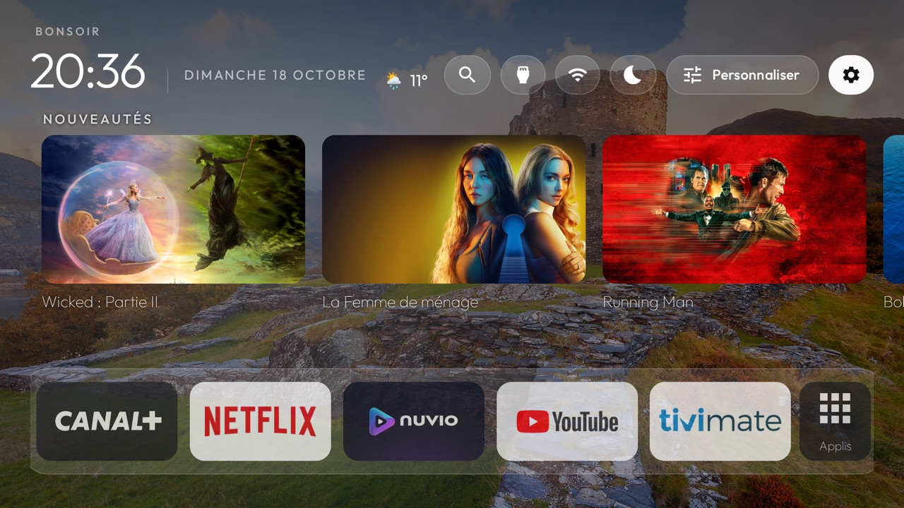
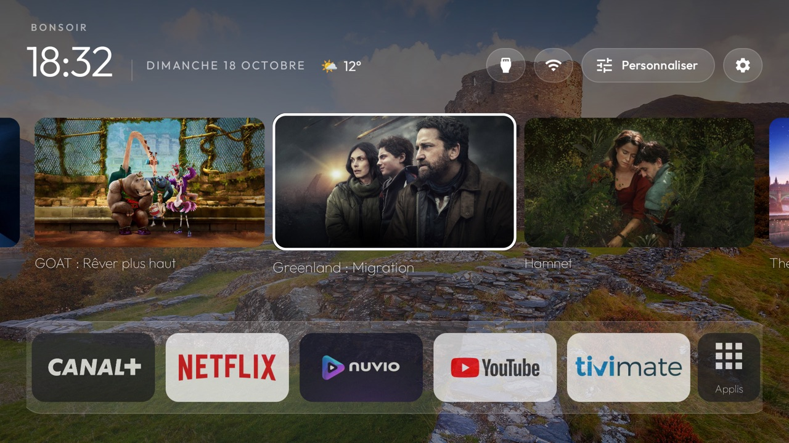
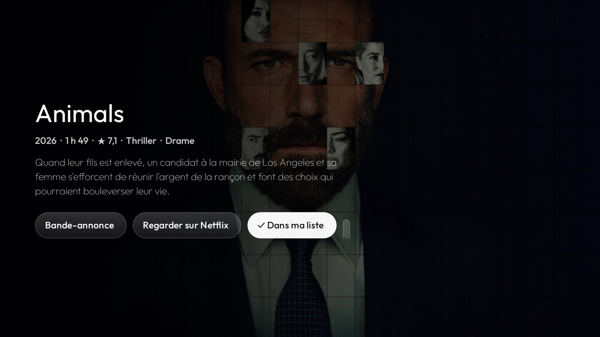
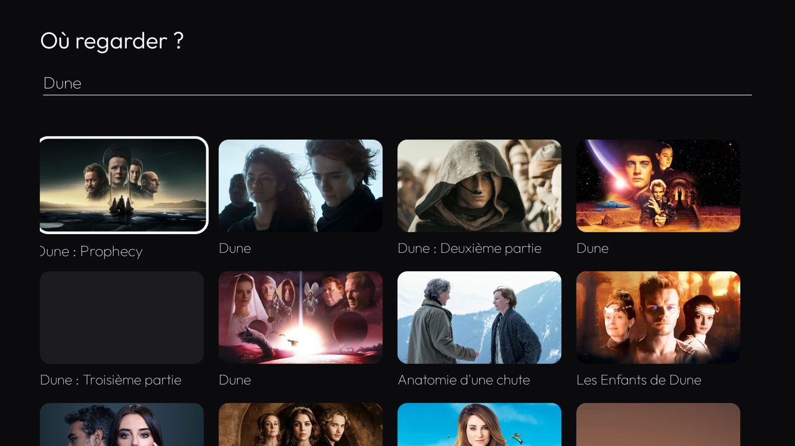
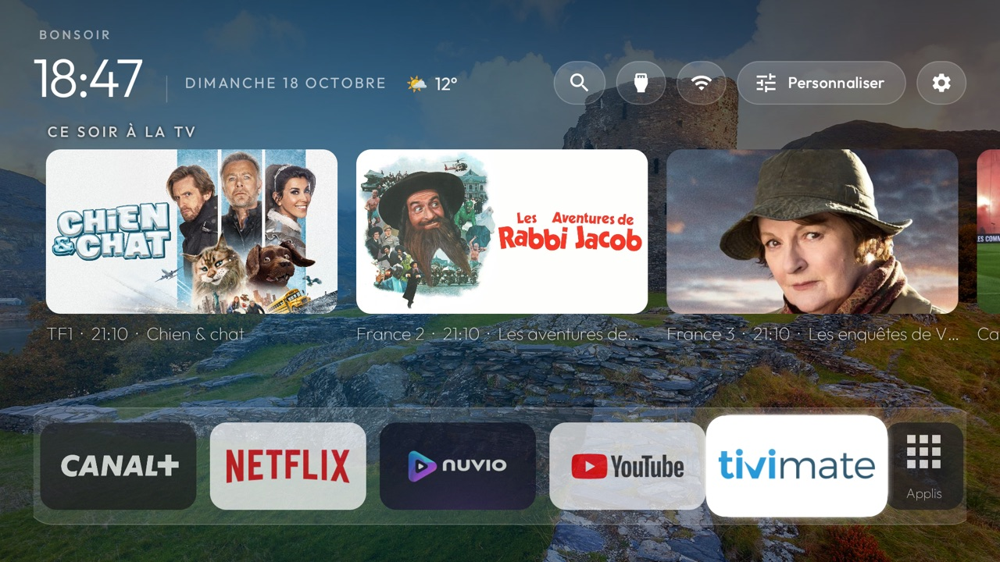
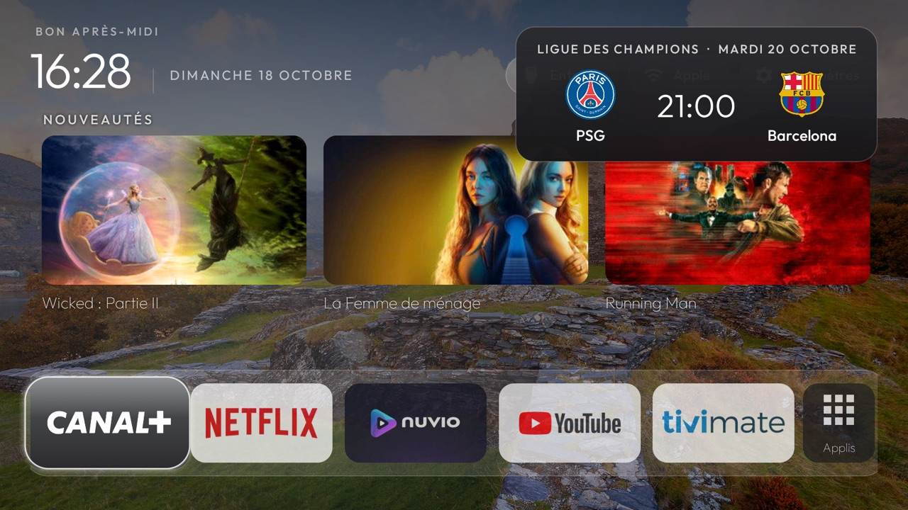
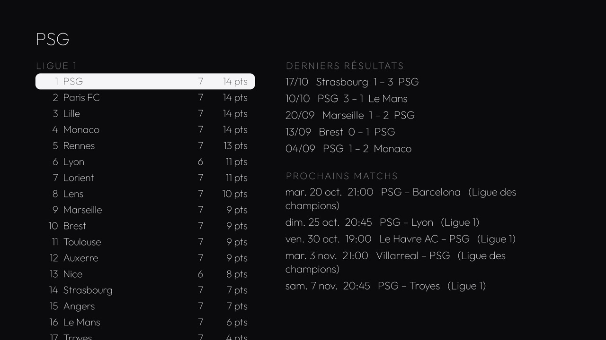
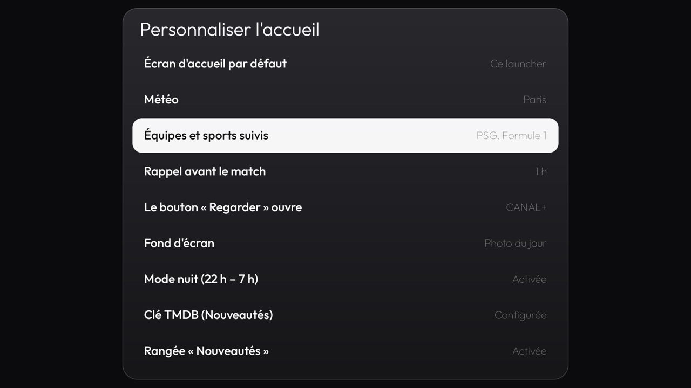

# Launcher TV

Un nouvel écran d'accueil pour les TV **Android TV / Google TV** (Sony, TCL, Philips, Xiaomi,
Chromecast avec Google TV…) : vos applis sur une seule ligne, une photo différente chaque jour,
les nouveautés de Netflix / Canal+ / Prime, la météo, le programme TV du soir et les matchs de vos
équipes.

## ⬇️ Télécharger

**[LauncherTV-ami.zip](https://github.com/dbaum69/tv-launcher-mises-a-jour/releases/latest/download/LauncherTV-ami.zip)**
— dernière version, avec les scripts d'installation pour Mac et Windows et le guide `LISEZ-MOI.txt`.

En bref : activez le mode développeur et le débogage sur la TV, dézippez sur un ordinateur relié au
même réseau, double-cliquez sur `installer-mac.command` ou `installer-windows.bat` et tapez l'adresse
IP de la TV. Tout est expliqué pas à pas dans `LISEZ-MOI.txt`.

Ne marche pas sur Samsung, LG ni Amazon Fire TV.

## Ce qu'on y trouve

| | |
|---|---|
|  **Nouveautés** au-dessus de chaque appli, à faire défiler |  **Fiche** : résumé, note, bande-annonce, « Regarder sur… », Ma liste |
|  **Où regarder ?** à la voix ou au clavier |  **Ce soir à la TV** sur les chaînes TNT |
|  **Rappel avant les matchs**, score en direct, buts, résumé |  **Page Sport** : classement, résultats, prochains matchs |

Et aussi : prévisions météo, minuterie de mise en veille, mode nuit, contrôle parental par code,
vos propres photos en fond d'écran, réglages depuis le téléphone par QR code, sauvegarde des réglages.

## Mises à jour

Une fois installé, le launcher vérifie deux fois par jour s'il existe une nouvelle version et
propose de l'installer : rien à refaire. La liste des versions est dans
[Releases](https://github.com/dbaum69/tv-launcher-mises-a-jour/releases).

## Revenir à l'écran d'origine

Lancez `restaurer-mac.command` ou `restaurer-windows.bat` (dans le zip) : l'écran d'accueil d'origine
de la TV est réactivé et ce launcher est supprimé.

---

Basé sur [tv-vibehack](https://github.com/Gathin23/tv-vibehack) de Gathin23 (licence MIT).
Données : Open-Meteo, ESPN, TMDB (ce produit utilise l'API TMDB mais n'est ni approuvé ni certifié
par TMDB), xmltvfr.fr, Bing. Les Nouveautés demandent une clé TMDB gratuite à saisir sur la TV.
